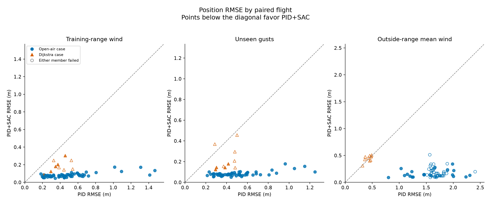
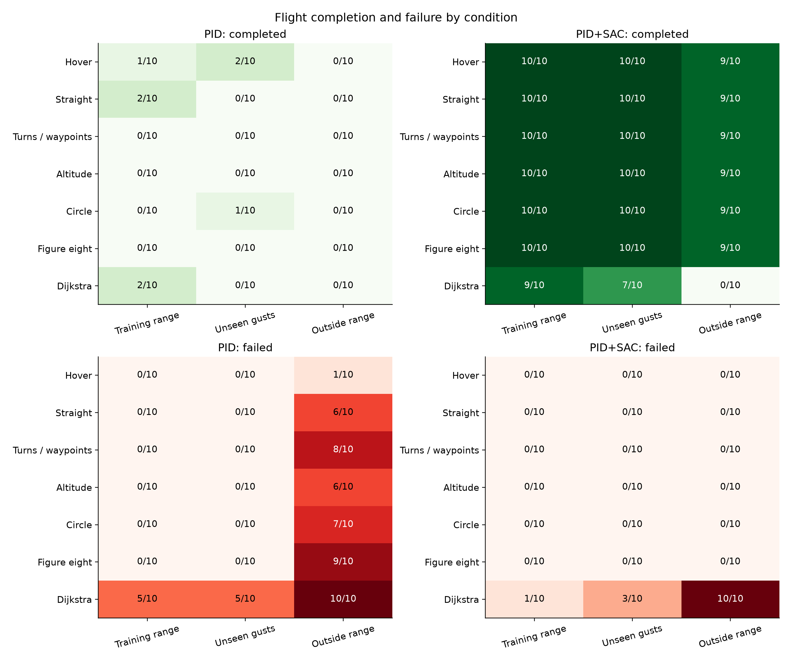
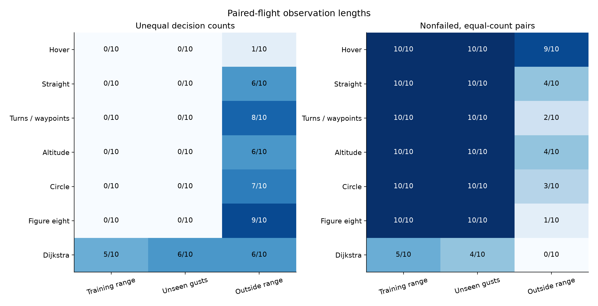
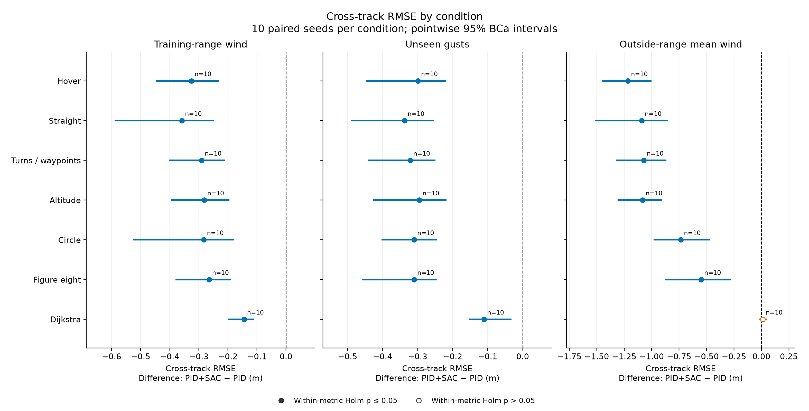
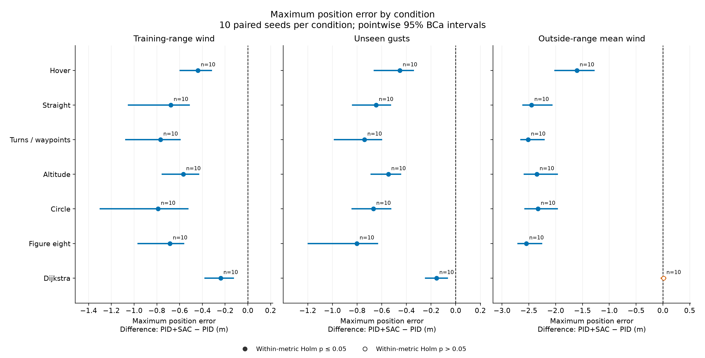
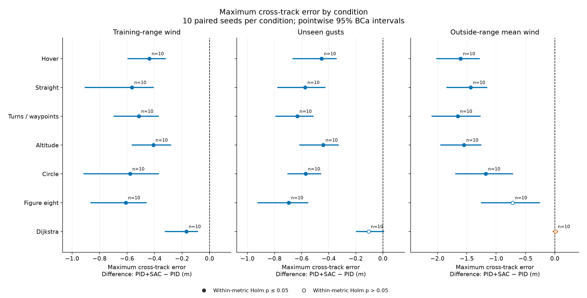
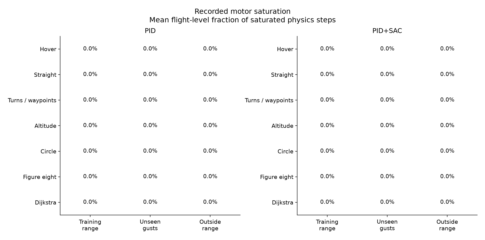

# Paired Evaluation of Residual Soft Actor–Critic Control for Multirotor Flight

**UC San Diego Data Science Capstone Project**

**Evaluation records:** 4 November 2026

**Statistical analysis:** 14 November 2026; numerical review 15 November 2026

## Abstract

We evaluated a residual Soft Actor–Critic (SAC) policy against a proportional–integral–derivative (PID) baseline using 420 Isaac Sim flight records. The retrospective study comprised 210 controller pairs across seven scenarios, three wind profiles, and ten environment seeds per condition. Paired differences were assessed with bootstrap confidence intervals and Holm-adjusted Wilcoxon signed-rank tests. SAC achieved lower position RMSE in all 180 open-air pairs. Mean flight-level RMSE decreased from 0.884 m to 0.115 m, an 87.0% reduction, with a mean paired difference of −0.769 m (95% seed-block interval: −0.873 to −0.685 m). Twenty of 21 primary comparisons were significant. Exploratory metric-wise tests supported reductions in cross-track RMSE and maximum position error in 20 conditions each, and maximum cross-track error in 18. Both controller modes failed all strong-wind Dijkstra cases during a phase consistent with residual-disabled launch. The results characterize one trained policy and PID configuration across the evaluated conditions.

## 1. Objective and experimental scope

Our objective was to measure the contribution of residual SAC to tracking accuracy and flight outcomes under wind disturbance. The policy adds four learned thrust and torque corrections to the PID command before motor mixing. Both controller modes use the same PID baseline.

We analyzed the fixed `flight1/final_model.zip` checkpoint, trained for 1,500,000 decisions with training seed 0. Its observation and action dimensions are 128 and four. Evaluation used a frozen deterministic policy and simulator ground-truth state. The statistical unit is a matched controller pair for one environment seed.

The evaluation includes six open-air scenarios—hover, straight flight, turns/waypoints, altitude changes, circle, and figure eight—and one Dijkstra obstacle-navigation scenario. The archived navigation experiment used a planned route of 6.98 m. Three wind profiles were evaluated:

| Wind profile | Experimental interpretation |
| --- | --- |
| Training range | Final-stage training wind ranges evaluated on designated evaluation seeds; mean wind 2–7 m/s |
| Unseen gusts | Stronger and faster gust disturbances than the training curriculum |
| Outside range | Mean wind 8–10 m/s, above the first checkpoint's 7 m/s final-stage mean-wind maximum |

Wind-speed ranges refer to the configured mean wind. The profile definitions are specific to the evaluated checkpoint.

## 2. Data integrity and paired design

Our dataset contains seven scenarios × three wind profiles × ten seeds × two controllers, yielding 420 flight records and 210 pairs. Seeds 300000–300009 are reused across conditions. We matched flights using scenario, wind profile, and environment seed, then verified agreement in recorded wind seed, mean wind speed when present, and reference-route duration.

All pairs were complete and unique. Flight CSV values agreed with the archived JSON and recomputed source summaries. Original source files and checksums were retained. The evaluation documentation describes shared routes and initial conditions; exact reset vectors and reference hashes were unavailable for independent verification.

An independent numerical audit checked 12,958 fields across the nine analytical tables against the original archived flight CSV. It enumerated exact-test sign assignments, calculated binomial probabilities, and reconstructed BCa intervals using an explicit jackknife. All checks passed within the specified numerical tolerances.

## 3. Statistical methods

### 3.1 Primary outcome and effect definition

The primary outcome is each flight's recorded position RMSE in metres. For condition *c* and seed *i*, we defined the paired difference as

$$
d_{c,i}=\mathrm{RMSE}_{\mathrm{PID+SAC},c,i}-\mathrm{RMSE}_{\mathrm{PID},c,i}.
$$

Negative values favor SAC. We report controller means, mean and median paired differences, paired-difference standard deviations, and counts of seeds favoring each controller. Percentage reduction is the difference between controller means divided by the PID mean.

### 3.2 Uncertainty and hypothesis tests

We constructed pointwise 95% bias-corrected and accelerated (BCa) bootstrap intervals for mean paired differences using 50,000 resamples. Resampling seeds were deterministic. For condition-level effects, we resampled complete paired differences. For overall benchmark effects, we first averaged the selected conditions within each environment seed, then resampled the ten resulting seed blocks. This preserves dependence associated with repeated seed identifiers.

Primary inference used two-sided Wilcoxon signed-rank tests with Holm adjustment across the 21 scenario–wind comparisons at α = 0.05. The null specifies a paired-difference distribution symmetric about zero. A separately adjusted exact sign-test family assessed the direction of the differences. Both test results are reported alongside mean effects and confidence intervals.

Confidence intervals are pointwise. Overall benchmarks give equal weight to the specified conditions and summarize mean flight-level RMSE within each environment seed.

### 3.3 Secondary outcomes and terminated flights

Secondary outcomes were cross-track RMSE, maximum position error, maximum cross-track error, and motor saturation fraction. Each metric was evaluated as a separate exploratory endpoint, with Holm adjustment across its 21 conditions. Exact sign tests used the same metric-wise grouping. A joint adjustment across all 84 secondary comparisons provided a sensitivity check (Appendix A). Error control therefore applies within each metric in the main secondary analysis.

Completion, failure, and reported collision were analyzed with exact McNemar tests and a separate 21-test adjustment for each outcome. Controller-rate intervals were exact binomial intervals. Completion required remaining within 0.15 m of the final goal at a speed below 0.2 m/s for 0.5 s.

Failed flights were retained in the primary analysis. Observation-length differences were examined using recorded decision counts. A separate sensitivity subset required both flights to be nonfailed and to have equal counts; estimates from this subset are conditional on those selection criteria.

## 4. Results

### 4.1 Open-air tracking

SAC produced lower recorded position RMSE in every open-air pair. Mean flight-level RMSE decreased substantially within each wind profile.

| Open-air wind profile | Pairs | PID mean RMSE (m) | PID+SAC mean RMSE (m) | Reduction | Pairs favoring SAC |
| --- | ---: | ---: | ---: | ---: | ---: |
| Training range | 60 | 0.502 | 0.082 | 83.6% | 60/60 |
| Unseen gusts | 60 | 0.497 | 0.082 | 83.5% | 60/60 |
| Outside range | 60 | 1.653 | 0.181 | 89.0% | 60/60 |

Across all 180 open-air pairs, mean flight-level RMSE was 0.884 m for PID and 0.115 m for PID+SAC. The mean paired difference was −0.769 m, with a pointwise 95% seed-block interval of [−0.873, −0.685] m. This corresponds to an 87.0% reduction in the equally weighted benchmark mean.

SAC's absolute error increased under outside-range mean wind, while its relative advantage over PID remained large. Training-range and unseen-gust profile means were similar.

*Figure 1. Mean paired effects for fixed benchmarks. Intervals resample ten whole seed blocks and provide pointwise 95% coverage.*

### 4.2 Condition-specific effects

Twenty of the 21 mean differences favored SAC. The same 20 conditions rejected the primary signed-rank null after Holm adjustment; their adjusted p-values were 0.04102. The separately adjusted sign tests also rejected in those 20 conditions. Strong-wind Dijkstra was the sole exception.

| Scenario | Wind profile | PID RMSE (m) | PID+SAC RMSE (m) | Difference (m) | Pointwise 95% CI (m) | SAC wins | Holm p |
| --- | --- | ---: | ---: | ---: | --- | ---: | ---: |
| Hover | Training range | 0.413 | 0.088 | −0.325 | [−0.446, −0.234] | 10/10 | 0.04102 |
| Hover | Unseen gusts | 0.387 | 0.088 | −0.299 | [−0.442, −0.221] | 10/10 | 0.04102 |
| Hover | Outside range | 1.432 | 0.216 | −1.216 | [−1.437, −1.006] | 10/10 | 0.04102 |
| Straight | Training range | 0.563 | 0.083 | −0.480 | [−0.786, −0.343] | 10/10 | 0.04102 |
| Straight | Unseen gusts | 0.505 | 0.083 | −0.422 | [−0.592, −0.324] | 10/10 | 0.04102 |
| Straight | Outside range | 1.784 | 0.173 | −1.611 | [−1.838, −1.427] | 10/10 | 0.04102 |
| Turns/waypoints | Training range | 0.541 | 0.086 | −0.455 | [−0.697, −0.342] | 10/10 | 0.04102 |
| Turns/waypoints | Unseen gusts | 0.551 | 0.085 | −0.466 | [−0.650, −0.373] | 10/10 | 0.04102 |
| Turns/waypoints | Outside range | 1.791 | 0.192 | −1.600 | [−1.783, −1.440] | 10/10 | 0.04102 |
| Altitude | Training range | 0.488 | 0.095 | −0.393 | [−0.541, −0.301] | 10/10 | 0.04102 |
| Altitude | Unseen gusts | 0.467 | 0.093 | −0.374 | [−0.520, −0.300] | 10/10 | 0.04102 |
| Altitude | Outside range | 1.705 | 0.193 | −1.512 | [−1.647, −1.357] | 10/10 | 0.04102 |
| Circle | Training range | 0.514 | 0.072 | −0.442 | [−0.768, −0.295] | 10/10 | 0.04102 |
| Circle | Unseen gusts | 0.504 | 0.072 | −0.432 | [−0.572, −0.335] | 10/10 | 0.04102 |
| Circle | Outside range | 1.569 | 0.161 | −1.408 | [−1.499, −1.327] | 10/10 | 0.04102 |
| Figure eight | Training range | 0.495 | 0.070 | −0.425 | [−0.609, −0.313] | 10/10 | 0.04102 |
| Figure eight | Unseen gusts | 0.567 | 0.071 | −0.496 | [−0.726, −0.382] | 10/10 | 0.04102 |
| Figure eight | Outside range | 1.634 | 0.153 | −1.481 | [−1.533, −1.410] | 10/10 | 0.04102 |
| Dijkstra | Training range | 0.391 | 0.186 | −0.205 | [−0.270, −0.159] | 10/10 | 0.04102 |
| Dijkstra | Unseen gusts | 0.399 | 0.221 | −0.178 | [−0.234, −0.087] | 9/10 | 0.04102 |
| Dijkstra | Outside range | 0.431 | 0.444 | +0.013 | [−0.015, +0.043] | 3/10 | 0.42578 |

*Figure 2. Paired mean position-RMSE differences by scenario and wind profile. Negative differences favor PID+SAC. Intervals are pointwise and are distinct from the Holm-adjusted tests.*

*Figure 3. Individual environment-seed differences. Crosses identify pairs with a failure in either controller mode.*

*Figure 4. PID and PID+SAC position RMSE for individual paired flights. Points below the diagonal favor SAC; hollow markers identify a failure in either member.*

### 4.3 Navigation and completion outcomes

We observed improved Dijkstra tracking and completion in the training-range and unseen-gust profiles. Both controller modes failed all ten outside-range navigation cases.

| Dijkstra wind profile | PID RMSE (m) | PID+SAC RMSE (m) | PID completed | PID+SAC completed |
| --- | ---: | ---: | ---: | ---: |
| Training range | 0.391 | 0.186 | 2/10 | 9/10 |
| Unseen gusts | 0.399 | 0.221 | 0/10 | 7/10 |
| Outside range | 0.431 | 0.444 | 0/10 | 0/10 |

In the outside-range condition, the mean RMSE difference was +0.013 m (pointwise 95% interval: −0.015 to +0.043 m; adjusted p = 0.42578). The interval and test result indicate uncertainty about the direction of this small recorded difference.

All 14 failed PID+SAC flights had zero recorded mean residual magnitude. This is consistent with the documented departure phase of approximately 2.8 s, during which the residual is disabled. Launch failures limit assessment of the policy's subsequent airborne behavior in those cases.

Across all evaluated cases, completion was substantially more frequent with PID+SAC. The pooled counts below are descriptive because seeds repeat across conditions.

| Recorded outcome | PID (n = 210) | PID+SAC (n = 210) |
| --- | ---: | ---: |
| Completed | 8 | 190 |
| Failed | 57 | 14 |
| Reported collision | 5 | 0 |

Among open-air cases, PID completed 6/180 and failed 37/180; PID+SAC completed 174/180 and failed 0/180. All 37 PID open-air failures occurred under outside-range wind. Completion counts reflect the final-goal settling criterion.

Eight condition-specific completion comparisons were significant after adjustment of exact McNemar tests. Failure and collision comparisons were nonsignificant within their respective families. Collision flags reflect the source workflow's geometric checks or proxies.

*Figure 5. Recorded completion and failure counts for each condition.*

### 4.4 Observation length and sensitivity analysis

Recorded decision counts differed in 54/210 pairs. Because error metrics summarize the observed portion of a flight, early termination can change both exposure duration and the route segments contributing to RMSE. The saved records do not permit common-time-window error reconstruction.

The sensitivity subset retained 152 pairs across 20 conditions. All represented mean differences favored SAC, and 13 signed-rank comparisons were significant after the separate sensitivity-family adjustment. Strong-wind Dijkstra had no eligible pairs. Selection by survival and decision count limits extrapolation of these results to the full benchmark.

*Figure 6. Pairs with unequal decision counts and pairs eligible for sensitivity analysis.*

*Figure 7. Conditional effects among nonfailed pairs with equal recorded decision counts. Subgroup sizes are shown beside the estimates.*

### 4.5 Secondary tracking and control measurements

Metric-wise comparisons supported improvements in both path adherence and peak tracking error. Cross-track RMSE and maximum position error were significantly lower with SAC in 20 of 21 conditions. Maximum cross-track error was significantly lower in 18 conditions. Each metric had lower SAC means in 20 conditions; outside-range Dijkstra was the sole positive mean difference.

| Secondary metric | Conditions with lower SAC mean | Significant signed-rank comparisons | Significant sign-test comparisons |
| --- | ---: | ---: | ---: |
| Cross-track RMSE | 20/21 | 20/21 | 20/21 |
| Maximum position error | 20/21 | 20/21 | 18/21 |
| Maximum cross-track error | 20/21 | 18/21 | 17/21 |
| Motor saturation fraction | 0/21 | 0/21 | 0/21 |

*Significance uses Holm-adjusted p ≤ 0.05 within each metric's 21-test family. These secondary comparisons are exploratory.*

For maximum cross-track error, figure-eight flight under outside-range wind and Dijkstra under unseen gusts had negative mean differences but adjusted signed-rank p-values of 0.08203 and 0.46484. Outside-range Dijkstra had a positive mean difference and adjusted p = 0.57031. The sign tests supported fewer maximum-error comparisons, reflecting differences in the frequency and ranked magnitude of improvements across seeds.

*Figure 8. Mean paired cross-track RMSE differences and pointwise 95% BCa intervals. Filled markers indicate within-metric Holm-adjusted signed-rank p ≤ 0.05.*

*Figure 9. Mean paired differences in flight-level maximum position error. Marker fill follows the same metric-wise significance convention.*

*Figure 10. Mean paired differences in flight-level maximum cross-track error.*

Motor saturation was zero in every recorded flight, giving zero paired differences and adjusted p = 1 throughout. Mean normalized SAC residual magnitude in open-air cases increased from 1.039 under training-range wind to 1.324 under outside-range wind, indicating larger corrections under stronger mean wind.

*Figure 11. Mean recorded motor saturation fraction for each controller, scenario, and wind profile.*

## 5. Discussion and limitations

Our results indicate that residual SAC improved the evaluated controller's recorded open-air tracking across all tested seeds. The effect was large in both familiar wind ranges and the designated unseen-disturbance profiles. The larger outside-range absolute errors nevertheless show that stronger mean wind continued to affect tracking quality.

The secondary tracking results support the primary pattern: SAC improved average path adherence and reduced flight-level peak errors across most conditions. Direction-only tests were less conclusive for some peak-error endpoints, indicating greater seed-to-seed variation in those outcomes.

Navigation results identify launch reliability as a separate system requirement. The evaluated PID gains, acceleration limits, and residual authority define the controller comparison. Alternative baseline tunings and disturbance-rejection methods warrant separate evaluation.

Inference is limited to ten environment seeds for one trained policy using simulator ground truth. Independent training runs, state-estimation uncertainty, latency, and physical flight remain untested. Repeated seed identifiers, unequal observation horizons, and small binary-outcome samples limit generalization and precision. Secondary p-values control error within each metric; the joint sensitivity analysis in Appendix A addresses the full secondary set.

Time-resolved tracking, disturbance recovery, directional wind effects, and correction–integral alignment require per-step reference, state, wind, correction, integral, and event traces. The available summaries support flight-level comparisons. As a retrospective study, the findings should be confirmed with declared endpoints and evaluation cases held out from tuning and model selection.

## 6. Conclusion

Residual SAC reduced mean open-air flight-level position RMSE by 87.0% relative to the specified PID baseline, with significant primary differences in 20 of 21 conditions. Exploratory metric-wise analyses also supported improved path adherence and lower peak errors. Strong-wind obstacle navigation remained unsuccessful during the residual-disabled launch phase. These findings support the policy's tracking contribution and identify takeoff reliability as a priority for further evaluation.

## Appendix A. Joint secondary-family sensitivity

We also adjusted the 84 secondary signed-rank tests as one family. This joint analysis yielded no significant comparisons for any metric. With ten pairs, the minimum two-sided exact p-value is 0.001953125, exceeding the first joint Holm threshold of 0.05/84 ≈ 0.000595. The joint correction therefore provides a conservative assessment of claims spanning all four secondary metrics.

The accompanying CSV retains both scopes: `wilcoxon_p_holm` and `sign_test_p_holm` use metric-wise adjustment; fields ending in `_holm_joint` contain the combined-family sensitivity results. All estimates and confidence intervals use the same paired observations and bootstrap draws.

## Data and analytical materials

The accompanying `tables/` directory contains paired records, primary and secondary effects, paired outcomes, seed-block summaries, observation-length diagnostics, and control-effort measurements. We retain original evaluation files and configuration evidence in `source_data/`, with input, code, and artifact checksums supporting traceability and reproducibility.

Detailed inference definitions and methodological references are provided in [the statistical methods document](../../METHODS.md). The numerical audit is recorded in `numerical_audit.json`; exact table reproduction and software tests are recorded in `verification.json`.
