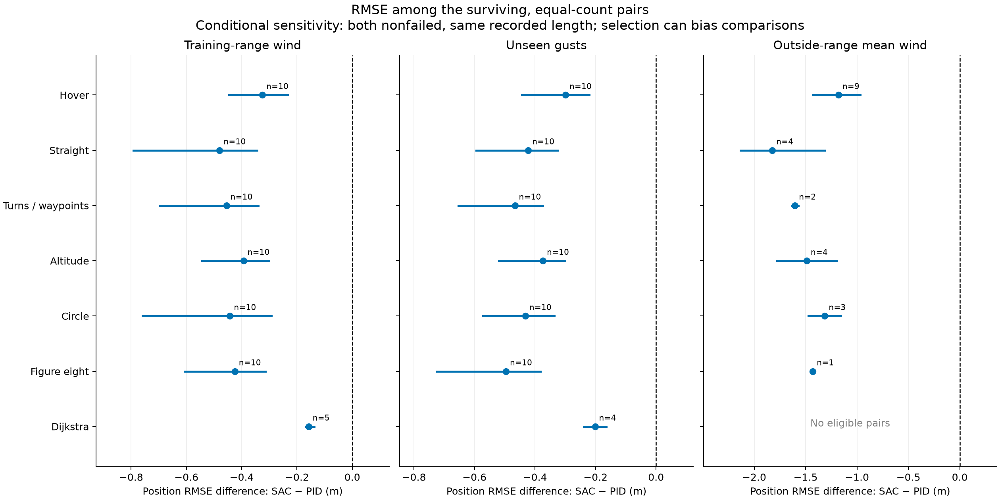

# Paired Evaluation of Residual Soft Actor–Critic Control for Multirotor Flight

**UC San Diego Data Science Capstone Project**

**Evaluation records:** 4 November 2026

**Statistical analysis:** 14 November 2026; numerical review 15 November 2026

## Abstract

We assessed whether a trained residual Soft Actor–Critic (SAC) policy improved multirotor flight control relative to a proportional–integral–derivative (PID) baseline. Our retrospective analysis comprised 420 Isaac Sim flight records, forming 210 controller pairs across seven flight scenarios, three wind profiles, and ten environment seeds per condition. We estimated paired differences in position root mean squared error (RMSE), constructed pointwise 95% bootstrap confidence intervals, and applied Holm-adjusted two-sided Wilcoxon signed-rank tests. SAC achieved lower recorded RMSE in all 180 open-air pairs. Across the equally weighted open-air benchmark, mean flight-level RMSE decreased from 0.884 m to 0.115 m, corresponding to an 87.0% reduction and a mean paired difference of −0.769 m (95% seed-block interval: −0.873 to −0.685 m). Twenty of the 21 condition-specific primary comparisons rejected the zero-centered signed-rank null after adjustment. Strong-wind Dijkstra navigation remained unsuccessful in both modes; zero recorded SAC corrections in failed flights were consistent with failure during the residual-disabled launch phase. Our findings support improved tracking for the evaluated checkpoint and PID configuration, subject to the limitations of one training lineage, ten environment seeds, and unequal observation lengths in terminated flights.

## 1. Objective and experimental scope

We examined the magnitude, consistency, and uncertainty of residual SAC's contribution to PID flight control. The evaluated controller adds four learned thrust and torque corrections to the PID command before motor mixing. Our comparison therefore concerns PID-only control and the same baseline augmented by the trained residual policy.

We analyzed the fixed `flight1/final_model.zip` checkpoint, which records 1,500,000 training decisions and training seed 0. Its observation and action dimensions are 128 and four, respectively. The recorded evaluation used a frozen deterministic policy and simulator ground-truth state. Our statistical unit is an environment-seed controller pair; independent policy-training runs are outside the study scope.

The evaluation includes six open-air scenarios—hover, straight flight, turns/waypoints, altitude changes, circle, and figure eight—and one Dijkstra obstacle-navigation scenario. The archived navigation experiment used a planned route of 6.98 m. Three wind profiles were evaluated:

| Wind profile | Experimental interpretation |
| --- | --- |
| Training range | Final-stage training wind ranges evaluated on designated evaluation seeds; mean wind 2–7 m/s |
| Unseen gusts | Stronger and faster gust disturbances than the training curriculum |
| Outside range | Mean wind 8–10 m/s, above the first checkpoint's 7 m/s final-stage mean-wind maximum |

These profile labels apply to this checkpoint. A mean-wind limit does not bound instantaneous wind during gusts. Training calm-flight probabilities do not define the weighting of the evaluation benchmark.

## 2. Data integrity and paired design

Our dataset contains seven scenarios × three wind profiles × ten seeds × two controllers, yielding 420 flight records and 210 pairs. Seeds 300000–300009 are reused across conditions. We matched flights using scenario, wind profile, and environment seed, then verified agreement in recorded wind seed, mean wind speed when present, and reference-route duration.

We found no duplicate flights or missing pairs. The flight CSV agreed with the archived JSON and recomputed source summaries. We retained the original source files and recorded their checksums. The evaluation documentation states that paired routes and initial conditions were shared; exact reset vectors and reference hashes are absent from the saved summaries, which limits independent verification of those additional matching properties.

We also conducted a separate numerical audit directly against the original archived flight CSV. This audit independently enumerated exact-test sign assignments, calculated binomial probabilities, reconstructed BCa intervals using an explicit jackknife, and checked 12,370 fields across all nine analytical tables. All checks passed within the specified numerical tolerances.

## 3. Statistical methods

### 3.1 Primary outcome and effect definition

The primary outcome is each flight's recorded position RMSE in metres. For condition *c* and seed *i*, we defined the paired difference as

$$
d_{c,i}=\mathrm{RMSE}_{\mathrm{PID+SAC},c,i}-\mathrm{RMSE}_{\mathrm{PID},c,i}.
$$

Negative values favor SAC. We report controller means, mean and median paired differences, paired-difference standard deviations, and counts of seeds favoring each controller. Percentage reduction is calculated from the two controller means, rather than by averaging seed-specific percentages.

### 3.2 Uncertainty and hypothesis tests

We constructed pointwise 95% bias-corrected and accelerated (BCa) bootstrap intervals for mean paired differences using 50,000 resamples. Resampling seeds were deterministic. For condition-level effects, we resampled complete paired differences. For overall benchmark effects, we first averaged the selected conditions within each environment seed, then resampled the ten resulting seed blocks. This preserves dependence associated with repeated seed identifiers.

Our primary hypothesis tests were two-sided Wilcoxon signed-rank tests, with Holm adjustment across the 21 scenario–wind comparisons at α = 0.05. The signed-rank null concerns a paired-difference distribution symmetric about zero; it is not a direct test of equality of means. A separately Holm-adjusted exact sign-test family assessed consistency of the direction of improvement. These two families were interpreted jointly without selecting the more favorable test.

Confidence intervals remain pointwise and are not simultaneous intervals across all conditions. The overview benchmark gives equal weight to its specified conditions; it does not estimate an unspecified operational flight distribution.

### 3.3 Secondary outcomes and terminated flights

Secondary continuous outcomes were cross-track RMSE, maximum position error, maximum cross-track error, and motor saturation fraction. We applied a separate Holm adjustment across their 84 condition-specific comparisons. Completion, failure, and reported collision were analyzed using exact McNemar tests, with a separate 21-test adjustment for each outcome. Controller-rate intervals were exact binomial intervals and did not represent paired rate-difference intervals.

We retained failed flights in the primary analysis. Recorded errors describe the observed flight portion, which can be shorter after termination. We therefore examined decision-count differences and conducted a separate sensitivity analysis restricted to pairs with no failure in either mode and equal recorded decision counts. This subset is conditional on survival and may introduce selection bias.

## 4. Results

### 4.1 Open-air tracking

SAC produced lower recorded position RMSE in every open-air pair. Mean flight-level RMSE decreased substantially within each wind profile.

| Open-air wind profile | Pairs | PID mean RMSE (m) | PID+SAC mean RMSE (m) | Reduction | Pairs favoring SAC |
| --- | ---: | ---: | ---: | ---: | ---: |
| Training range | 60 | 0.502 | 0.082 | 83.6% | 60/60 |
| Unseen gusts | 60 | 0.497 | 0.082 | 83.5% | 60/60 |
| Outside range | 60 | 1.653 | 0.181 | 89.0% | 60/60 |

Across all 180 open-air pairs, the equally weighted mean flight-level RMSE was 0.884 m for PID and 0.115 m for PID+SAC. The mean paired difference was −0.769 m, with a pointwise 95% seed-block interval of [−0.873, −0.685] m. This corresponds to an 87.0% reduction in the benchmark mean. These values average per-flight RMSE; they are not RMSE values calculated by concatenating all time samples.

SAC's absolute error increased under outside-range mean wind, although its relative advantage over PID remained large. Similar averages in the training-range and unseen-gust profiles do not establish equivalence between those conditions.

*Figure 1. Mean paired effects for fixed benchmarks. Intervals resample ten whole seed blocks and provide pointwise 95% coverage.*

### 4.2 Condition-specific effects

Twenty of the 21 mean differences favored SAC. The same 20 conditions rejected the primary signed-rank null after Holm adjustment; their adjusted p-values were 0.04102. The separately adjusted sign tests also rejected in those 20 conditions. Strong-wind Dijkstra was the sole exception.

| Scenario | Wind profile | PID RMSE (m) | PID+SAC RMSE (m) | Difference (m) | Pointwise 95% CI (m) | SAC wins | Holm p |
| --- | --- | ---: | ---: | ---: | --- | ---: | ---: |
| Hover | Training range | 0.413 | 0.088 | −0.325 | [−0.446, −0.234] | 10/10 | 0.04102 |
| Hover | Unseen gusts | 0.387 | 0.088 | −0.299 | [−0.442, −0.221] | 10/10 | 0.04102 |
| Hover | Outside range | 1.432 | 0.216 | −1.216 | [−1.437, −1.006] | 10/10 | 0.04102 |
| Straight | Training range | 0.563 | 0.083 | −0.480 | [−0.786, −0.343] | 10/10 | 0.04102 |
| Straight | Unseen gusts | 0.505 | 0.083 | −0.422 | [−0.592, −0.324] | 10/10 | 0.04102 |
| Straight | Outside range | 1.784 | 0.173 | −1.611 | [−1.838, −1.427] | 10/10 | 0.04102 |
| Turns/waypoints | Training range | 0.541 | 0.086 | −0.455 | [−0.697, −0.342] | 10/10 | 0.04102 |
| Turns/waypoints | Unseen gusts | 0.551 | 0.085 | −0.466 | [−0.650, −0.373] | 10/10 | 0.04102 |
| Turns/waypoints | Outside range | 1.791 | 0.192 | −1.600 | [−1.783, −1.440] | 10/10 | 0.04102 |
| Altitude | Training range | 0.488 | 0.095 | −0.393 | [−0.541, −0.301] | 10/10 | 0.04102 |
| Altitude | Unseen gusts | 0.467 | 0.093 | −0.374 | [−0.520, −0.300] | 10/10 | 0.04102 |
| Altitude | Outside range | 1.705 | 0.193 | −1.512 | [−1.647, −1.357] | 10/10 | 0.04102 |
| Circle | Training range | 0.514 | 0.072 | −0.442 | [−0.768, −0.295] | 10/10 | 0.04102 |
| Circle | Unseen gusts | 0.504 | 0.072 | −0.432 | [−0.572, −0.335] | 10/10 | 0.04102 |
| Circle | Outside range | 1.569 | 0.161 | −1.408 | [−1.499, −1.327] | 10/10 | 0.04102 |
| Figure eight | Training range | 0.495 | 0.070 | −0.425 | [−0.609, −0.313] | 10/10 | 0.04102 |
| Figure eight | Unseen gusts | 0.567 | 0.071 | −0.496 | [−0.726, −0.382] | 10/10 | 0.04102 |
| Figure eight | Outside range | 1.634 | 0.153 | −1.481 | [−1.533, −1.410] | 10/10 | 0.04102 |
| Dijkstra | Training range | 0.391 | 0.186 | −0.205 | [−0.270, −0.159] | 10/10 | 0.04102 |
| Dijkstra | Unseen gusts | 0.399 | 0.221 | −0.178 | [−0.234, −0.087] | 9/10 | 0.04102 |
| Dijkstra | Outside range | 0.431 | 0.444 | +0.013 | [−0.015, +0.043] | 3/10 | 0.42578 |

*Figure 2. Paired mean position-RMSE differences by scenario and wind profile. Negative differences favor PID+SAC. Intervals are pointwise and are distinct from the Holm-adjusted tests.*

*Figure 3. Individual environment-seed differences. Crosses identify pairs with a failure in either controller mode.*

### 4.3 Navigation and completion outcomes

We observed improved Dijkstra tracking and completion in the training-range and unseen-gust profiles. Both controller modes failed all ten outside-range navigation cases.

| Dijkstra wind profile | PID RMSE (m) | PID+SAC RMSE (m) | PID completed | PID+SAC completed |
| --- | ---: | ---: | ---: | ---: |
| Training range | 0.391 | 0.186 | 2/10 | 9/10 |
| Unseen gusts | 0.399 | 0.221 | 0/10 | 7/10 |
| Outside range | 0.431 | 0.444 | 0/10 | 0/10 |

In the outside-range condition, the mean RMSE difference was +0.013 m (pointwise 95% interval: −0.015 to +0.043 m; adjusted p = 0.42578). We did not detect a reliable error difference in this condition. Non-rejection does not establish equivalent controller performance.

All 14 failed PID+SAC flights had zero recorded mean residual magnitude. The evaluation documentation describes an approximately 2.8 s departure phase during which the residual is disabled. Together, these observations are consistent with launch-stage failure. They characterize the complete navigation system but do not isolate the behavior of an engaged airborne SAC controller during those failed cases.

Across all evaluated cases, completion was substantially more frequent with PID+SAC. The pooled counts below are descriptive because seeds repeat across conditions.

| Recorded outcome | PID (n = 210) | PID+SAC (n = 210) |
| --- | ---: | ---: |
| Completed | 8 | 190 |
| Failed | 57 | 14 |
| Reported collision | 5 | 0 |

Among open-air cases, PID completed 6/180 and failed 37/180; PID+SAC completed 174/180 and failed 0/180. All 37 PID open-air failures occurred under outside-range wind. Absence of failure did not necessarily satisfy the evaluator's completion criterion.

Eight condition-specific completion comparisons rejected after Holm adjustment of exact McNemar tests. No individual failure or collision comparison rejected within its adjusted family. These outcomes distinguish descriptive changes in counts from condition-specific inferential conclusions. Collision flags reflect the source workflow's geometric checks or proxies.

*Figure 4. Recorded completion and failure counts for each condition. Completion and failure are separate outcomes.*

### 4.4 Observation length and sensitivity analysis

Recorded decision counts differed in 54/210 pairs. Because error metrics summarize the observed portion of a flight, early termination can change both exposure duration and the route segments contributing to RMSE. The saved records do not permit common-time-window error reconstruction.

Our survivor-conditioned, equal-count subset retained 152 pairs across 20 conditions. Mean differences favored SAC in every represented condition, and 13 signed-rank comparisons rejected after the separate sensitivity-family adjustment. The subset excluded strong-wind Dijkstra entirely. These results are consistent with the primary direction of effect, while remaining subject to selection induced by survival and equal-count requirements.

*Figure 5. Counts of pairs with unequal decision counts and pairs eligible for sensitivity analysis. Decision counts diagnose observation length but are not precise failure timestamps.*

*Figure 6. Conditional effects among nonfailed pairs with equal recorded decision counts. Small subgroup sizes limit interval precision; empty conditions provide no estimate.*

### 4.5 Secondary tracking and control measurements

None of the 84 secondary continuous signed-rank comparisons rejected after Holm adjustment. With ten nonzero pairs, the minimum two-sided exact p-value is 0.001953125, exceeding the first 84-test Holm threshold of approximately 0.000595. This family therefore cannot produce a rejection at the current sample size under these exact tests. Non-rejection does not establish absence of an effect.

Recorded motor saturation was zero in all flights. Mean normalized SAC residual magnitude in open-air cases increased from 1.039 under training-range wind to 1.324 under outside-range wind. These measurements describe action magnitude and clipping; they do not establish energy efficiency, correction direction, alignment with wind, or operational safety.

*Figure 7. Individual PID and PID+SAC flight-level RMSE values. Points below the diagonal favor SAC; hollow markers identify a failure in either paired flight.*

## 5. Discussion and limitations

Our results indicate that residual SAC improved the evaluated controller's recorded open-air tracking across all tested seeds. The effect was large in both familiar wind ranges and the designated unseen-disturbance profiles. The larger outside-range absolute errors nevertheless show that stronger mean wind continued to affect tracking quality.

The navigation findings identify launch behavior as an important system-level limitation. Successful tracking after departure and successful takeoff under disturbance are distinct requirements; aggregate RMSE alone cannot establish mission reliability. The baseline gains, acceleration limits, and residual authority also define the comparison. We have not established superiority over other PID tunings or alternative disturbance-rejection controllers.

Our inference concerns variation across ten environment seeds for one trained policy. It does not quantify variation across independent training runs. The evaluation uses simulator ground truth and does not assess state-estimation noise, latency, or physical flight. Repeated seed identifiers, unequal observation horizons, and small binary-outcome samples further limit generalization and precision.

The saved summaries do not contain the per-step reference, state, wind, correction, integral, and event traces needed for error-over-time curves, event-recovery estimates, directional wind classification, or correction–integral alignment. Completion time measures the final-goal outcome and cannot substitute for recovery after a disturbance. Our analysis is retrospective; a subsequent confirmatory study should use declared endpoints and evaluation seeds held out from tuning and model selection.

## 6. Conclusion

We found a substantial and consistent reduction in recorded open-air position-tracking error when the trained residual SAC policy augmented the specified PID controller. Mean flight-level RMSE decreased by 87.0% across the equally weighted open-air benchmark, and 20 of 21 condition-specific primary tests rejected after multiplicity adjustment. Strong-wind obstacle navigation remained unsuccessful during the residual-disabled launch phase. These findings support the evaluated policy's tracking contribution while identifying takeoff reliability and broader validation as separate requirements.

## Data and analytical materials

The accompanying `tables/` directory contains paired records, primary and secondary effects, paired outcomes, seed-block summaries, observation-length diagnostics, and control-effort measurements. We retain original evaluation files and configuration evidence in `source_data/`, with input, code, and artifact checksums supporting traceability and reproducibility.

Detailed inference definitions and methodological references are provided in [the statistical methods document](../../METHODS.md). The numerical audit is recorded in `numerical_audit.json`; exact table reproduction and software tests are recorded in `verification.json`.
