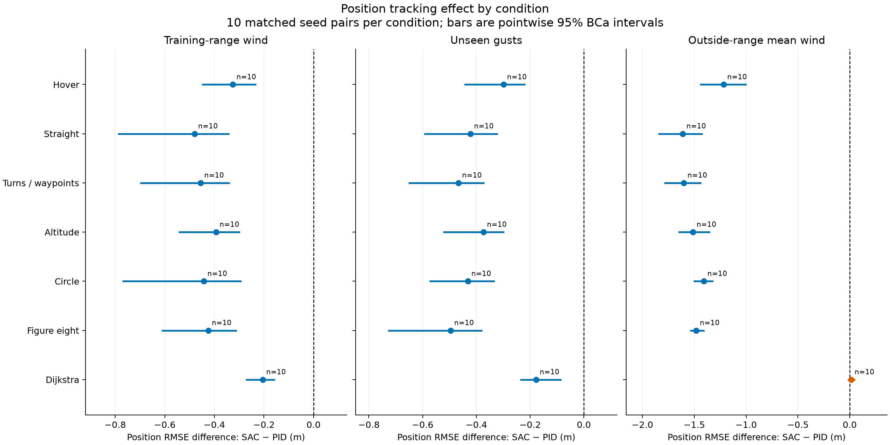
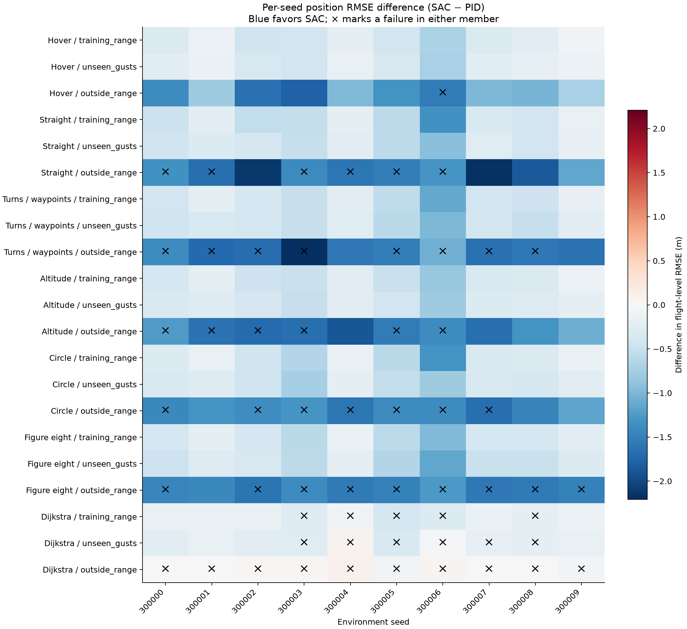
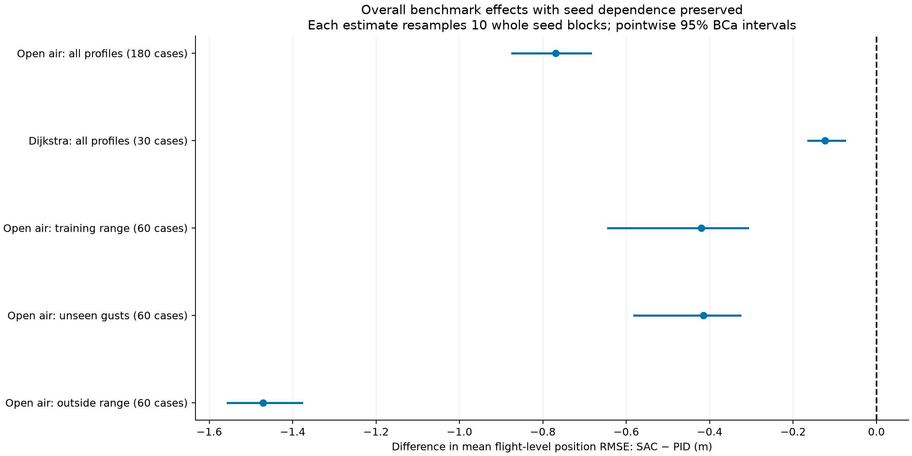

# Paired PID versus PID+SAC statistical analysis

Analysis date: 2026-11-14. **Exploratory retrospective analysis of archived Isaac Sim results.**

The archive contains 420 evaluated flights forming 210 matched cases in 21 scenario/wind conditions, with 10 environment seeds per condition. SAC has lower recorded position RMSE in 180/180 open-air paired cases. Across all conditions, 20/21 mean differences favor SAC; 20/21 primary two-sided Wilcoxon tests reject after Holm correction. These results concern the archived checkpoint and its particular PID baseline. They do not establish real-flight performance, training-seed robustness, or cross-simulator agreement.

## Model, source data and scope

The target is `runs/flight_sac/flight1/final_model.zip`, verified from its JSON metadata at **1,500,000 training decisions**, 1,494,999 gradient updates, training seed 0, 128 observation values and four residual actions. The policy was not loaded or deserialized, and neither training nor simulation was run for this analysis.

- Model ZIP SHA-256: `2d9e5cd0df1a3cbabf8ae2eaa75884783c9c16bf6a3ced737398291b0b67023d`.
- Original archive SHA-256: `0c3b9fcd25ae02491bf9c56b77550b8adbe2037d693438f0f4c5732f4336369c`.
- The original CSV, JSON, summary, provided PDF and configuration snapshots are preserved in `source_data/`.
- Duplicate identifiers, missing pairs, mismatched recorded wind seeds/speeds or route durations, non-finite metrics and disagreement with source summaries cause explicit errors.
- The available recorded pairing fields match. Exact initial-state vectors and reference hashes are not stored in the evaluation output, so their equality cannot be independently reconstructed from this CSV alone.

The target's curriculum gradually reaches 2–7 m/s mean wind, gust scale 0.5–1.0 and wind turn rate up to 0.2 rad/s. `training_range` evaluates within those final-stage wind ranges on new seeds; `unseen_gusts` uses stronger/faster disturbances; `outside_range` uses 8–10 m/s mean wind. Training calm-flight percentages are not evaluation weights. A mean-wind limit is not an instantaneous gust-speed limit.

The archive also contains `flight2`, a continuation to 2.5 million total steps with added stages reaching 14 m/s mean wind, but no saved evaluation for that run. Flight2 and intermediate checkpoints are not independent training replicates. The first model's outside-range label must not be reused as an out-of-training claim for flight2.

## Statistical methods

Pairs use `(scenario, wind_profile, seed)`. The primary effect is **position RMSE(SAC) − position RMSE(PID)**; negative values favor SAC. Point estimates, medians, paired-difference standard deviations and counts of lower/tied errors are provided. Pointwise 95% BCa bootstrap intervals use 50,000 resamples with deterministic, group-specific random seeds derived from master seed 20261114. Whole paired differences are resampled, not individual physics samples. Intervals are not simultaneous confidence bands.

Two-sided Wilcoxon signed-rank tests use exact calculations for distinct, nonzero differences and permutation calculations for tied/zero samples. Only rank-test differences are rounded to 12 decimal places to avoid spurious floating-point ranks. The test's symmetry and independent-seed assumptions remain important. A two-sided exact sign test provides a direction-only robustness check. Holm corrections are applied separately to the 21 primary Wilcoxon p-values and the 21 sign-test p-values at alpha 0.05. The two tests address different features of the paired differences; they are reported together, not selected according to which is favorable.

Secondary continuous metrics are cross-track RMSE, per-flight maximum position error, per-flight maximum cross-track error and saturation fraction. Their 84 tests form a separate Holm-adjusted family for each test type. Outcome analyses use exact McNemar tests on discordant paired flags, with a separate 21-test Holm family for each outcome (completion, failure and reported collision). Controller-specific proportion intervals are exact binomial intervals; they are marginal intervals, not confidence intervals for a paired rate difference. All-zero/constant samples are flagged and do not establish population equivalence.

There are **10 unique evaluation seed identifiers**, reused across conditions. Overall summaries first average the chosen fixed benchmark conditions within each seed, then resample these 10 whole seed blocks. They do not pretend the 210 cases are independent seed draws. The weighting is equal across selected benchmark conditions; it is not an estimate of an unspecified real-world or training-mixture distribution.

## Primary effects by condition

Each row uses all recorded pairs, including failures. Units are metres. `Wins` counts seeds with lower SAC error. Adjusted p-values below are the primary Wilcoxon family; confidence intervals remain pointwise.

| Scenario | Wind profile | PID mean RMSE | SAC mean RMSE | SAC − PID | 95% CI | SAC wins | Holm p |
| --- | --- | ---: | ---: | ---: | --- | ---: | ---: |
| hover | training_range | 0.413 | 0.088 | -0.325 | [-0.446, -0.234] | 10/10 | 0.04102 |
| hover | unseen_gusts | 0.387 | 0.088 | -0.299 | [-0.442, -0.221] | 10/10 | 0.04102 |
| hover | outside_range | 1.432 | 0.216 | -1.216 | [-1.437, -1.006] | 10/10 | 0.04102 |
| straight | training_range | 0.563 | 0.083 | -0.480 | [-0.786, -0.343] | 10/10 | 0.04102 |
| straight | unseen_gusts | 0.505 | 0.083 | -0.422 | [-0.592, -0.324] | 10/10 | 0.04102 |
| straight | outside_range | 1.784 | 0.173 | -1.611 | [-1.838, -1.427] | 10/10 | 0.04102 |
| turns | training_range | 0.541 | 0.086 | -0.455 | [-0.697, -0.342] | 10/10 | 0.04102 |
| turns | unseen_gusts | 0.551 | 0.085 | -0.466 | [-0.650, -0.373] | 10/10 | 0.04102 |
| turns | outside_range | 1.791 | 0.192 | -1.600 | [-1.783, -1.440] | 10/10 | 0.04102 |
| altitude | training_range | 0.488 | 0.095 | -0.393 | [-0.541, -0.301] | 10/10 | 0.04102 |
| altitude | unseen_gusts | 0.467 | 0.093 | -0.374 | [-0.520, -0.300] | 10/10 | 0.04102 |
| altitude | outside_range | 1.705 | 0.193 | -1.512 | [-1.647, -1.357] | 10/10 | 0.04102 |
| circle | training_range | 0.514 | 0.072 | -0.442 | [-0.768, -0.295] | 10/10 | 0.04102 |
| circle | unseen_gusts | 0.504 | 0.072 | -0.432 | [-0.572, -0.335] | 10/10 | 0.04102 |
| circle | outside_range | 1.569 | 0.161 | -1.408 | [-1.499, -1.327] | 10/10 | 0.04102 |
| figure_eight | training_range | 0.495 | 0.070 | -0.425 | [-0.609, -0.313] | 10/10 | 0.04102 |
| figure_eight | unseen_gusts | 0.567 | 0.071 | -0.496 | [-0.726, -0.382] | 10/10 | 0.04102 |
| figure_eight | outside_range | 1.634 | 0.153 | -1.481 | [-1.533, -1.410] | 10/10 | 0.04102 |
| dijkstra | training_range | 0.391 | 0.186 | -0.205 | [-0.270, -0.159] | 10/10 | 0.04102 |
| dijkstra | unseen_gusts | 0.399 | 0.221 | -0.178 | [-0.234, -0.087] | 9/10 | 0.04102 |
| dijkstra | outside_range | 0.431 | 0.444 | +0.013 | [-0.015, 0.043] | 3/10 | 0.42578 |

## Overall effects with repeated seeds grouped

These are differences in **means of flight-level RMSE**, not RMSE of concatenated time samples. Each interval resamples whole seed blocks.

| Fixed benchmark | Paired cases | Independent seed blocks | PID mean | SAC mean | Difference | Pointwise 95% CI |
| --- | ---: | ---: | ---: | ---: | ---: | --- |
| open_air_all_profiles | 180 | 10 | 0.884 | 0.115 | -0.769 | [-0.873, -0.685] |
| dijkstra_all_profiles | 30 | 10 | 0.407 | 0.284 | -0.123 | [-0.164, -0.076] |
| open_air_training_range | 60 | 10 | 0.502 | 0.082 | -0.420 | [-0.643, -0.308] |
| open_air_unseen_gusts | 60 | 10 | 0.497 | 0.082 | -0.415 | [-0.581, -0.327] |
| open_air_outside_range | 60 | 10 | 1.653 | 0.181 | -1.471 | [-1.556, -1.378] |

## Outcomes and observed flight length

Across all 210 cases, PID reports 8 completions, 57 failures and 5 collisions. PID+SAC reports 190 completions, 14 failures and 0 collisions. These pooled counts are descriptive. No recorded failure is not the same as completion. Collision flags come from the source workflow's geometric checks/proxies, not a newly verified native-contact measurement.

| Scenario | Wind | PID completed | SAC completed | PID failed | SAC failed | Completion McNemar Holm p |
| --- | --- | ---: | ---: | ---: | ---: | ---: |
| hover | training_range | 1/10 | 10/10 | 0/10 | 0/10 | 0.05078 |
| hover | unseen_gusts | 2/10 | 10/10 | 0/10 | 0/10 | 0.05078 |
| hover | outside_range | 0/10 | 9/10 | 1/10 | 0/10 | 0.05078 |
| straight | training_range | 2/10 | 10/10 | 0/10 | 0/10 | 0.05078 |
| straight | unseen_gusts | 0/10 | 10/10 | 0/10 | 0/10 | 0.04102 |
| straight | outside_range | 0/10 | 9/10 | 6/10 | 0/10 | 0.05078 |
| turns | training_range | 0/10 | 10/10 | 0/10 | 0/10 | 0.04102 |
| turns | unseen_gusts | 0/10 | 10/10 | 0/10 | 0/10 | 0.04102 |
| turns | outside_range | 0/10 | 9/10 | 8/10 | 0/10 | 0.05078 |
| altitude | training_range | 0/10 | 10/10 | 0/10 | 0/10 | 0.04102 |
| altitude | unseen_gusts | 0/10 | 10/10 | 0/10 | 0/10 | 0.04102 |
| altitude | outside_range | 0/10 | 9/10 | 6/10 | 0/10 | 0.05078 |
| circle | training_range | 0/10 | 10/10 | 0/10 | 0/10 | 0.04102 |
| circle | unseen_gusts | 1/10 | 10/10 | 0/10 | 0/10 | 0.05078 |
| circle | outside_range | 0/10 | 9/10 | 7/10 | 0/10 | 0.05078 |
| figure_eight | training_range | 0/10 | 10/10 | 0/10 | 0/10 | 0.04102 |
| figure_eight | unseen_gusts | 0/10 | 10/10 | 0/10 | 0/10 | 0.04102 |
| figure_eight | outside_range | 0/10 | 9/10 | 9/10 | 0/10 | 0.05078 |
| dijkstra | training_range | 2/10 | 9/10 | 5/10 | 1/10 | 0.05078 |
| dijkstra | unseen_gusts | 0/10 | 7/10 | 5/10 | 3/10 | 0.05078 |
| dijkstra | outside_range | 0/10 | 0/10 | 10/10 | 10/10 | 1.00000 |

**54/210 pairs have different recorded decision counts.** The original metrics average what was flown. A short terminated flight and a full surviving flight therefore have different observed horizons. Decision counts diagnose this issue but do not provide precise termination timestamps. Raw trajectories are missing, so common-time-window RMSE cannot be recomputed.

A secondary sensitivity table keeps only pairs with no recorded failure in either mode and identical decision counts. This is explicitly survivor-conditioned, can introduce selection bias, and does not replace the all-pair results. The relevant outputs are `tables/observed_lengths.csv` and `tables/sensitivity_rmse.csv`.

## Dijkstra takeoff limitation

Under outside-range wind, both modes fail all 10 cases. The mean error difference is +0.013 m with pointwise interval [-0.015, 0.043]. All SAC failures in the dataset with zero recorded mean residual number 14. The supplied report describes a roughly 2.8 s departure during which the residual is disabled; the zero-residual records support that explanation. These are full navigation-system/takeoff outcomes, not evidence of how an engaged SAC controller performs airborne in those cases. The archive does not contain the full per-step logs needed to reconstruct every event independently.

The archived obstacle route is reported as **6.98 m**. The current repository's longer warehouse destination is a different experiment. Any additional evaluation must preserve or explicitly version the route, launch rules, model identity and wind configuration rather than append incompatible cases.

## Secondary measurements and unavailable questions

The secondary continuous family has 0/84 Holm-adjusted Wilcoxon rejections. With only ten nonzero pairs, the minimum two-sided exact signed-rank p-value is 2/1024; the first Holm threshold for 84 comparisons is 0.05/84. This makes that secondary family very conservative. Failure to reject there does not establish no effect. Secondary point estimates and pointwise intervals remain available for exploratory interpretation.

Residual magnitude/change and saturation are described in `tables/control_effort_descriptive.csv`. Residual norms are normalized action magnitudes, not physical energy, signed torque direction, or alignment with wind. Zero saturation describes the recorded actuator clipping metric; it does not prove safety or zero control effort.

The saved evaluation does **not** support error-over-time curves, sustained post-event recovery, headwind/tailwind/crosswind classification, or correction alignment with wind and PID integral terms. Those require per-step evaluation traces with reference/state/wind vectors, corrections, integrals and event times. Final-goal completion time is not event recovery time. Training progress logs and replay buffers are not substitutes for held-out evaluation trajectories.

## Report-ready conclusion and next work

For the archived first checkpoint, adding SAC substantially reduces the recorded open-air tracking error relative to the specified PID. The equally weighted open-air benchmark has a mean paired difference of -0.769 m, with a seed-block pointwise 95% interval of [-0.873, -0.685]. Dijkstra results expose a separate launch limitation and should be presented independently. Inference concerns variation across environment seeds for this checkpoint; both archived path models share one training lineage. A stronger PID baseline, independently trained SAC policies and fresh held-out evaluation cases would be separate extensions.

1. Review these retrospective results and agree on a small set of primary claims.
2. Keep the model hash, baseline gains and condition definitions fixed for a confirmation study.
3. Use fresh seeds if these ten already informed tuning/model selection; add runs based on required precision rather than promising that a fixed seed count guarantees power.
4. Let the teammate responsible for temporal analysis collect the missing time-series/event measurements. No additional simulation is required to reproduce the current statistical tables.
5. Evaluate flight2 separately if desired. Its 8–10 m/s cases are within its expanded mean-wind training range, and it is not an independent training seed.

## Files and reproducibility

- `analysis_report.pdf`: overview and scientific figures.
- `report_section.tex`: standalone subsection for inclusion in the team report; adjust figure paths as needed.
- `tables/`: all pairs, condition effects, paired outcomes, observed-length diagnostics, survivor-conditioned sensitivity and seed-cluster summaries.
- `source_data/`: original small archived files and saved metadata, with hashes in provenance.
- `provenance.json`, `validation.json`, `summary.json`, `outputs_manifest.json`: parameters, input/code/version hashes, checks and all output checksums.
- `../../METHODS.md`: method definitions, inference families and statistical references.

No simulation/controller source, model weights, training settings or Git branches were modified by this pipeline. Only the new analysis directory and its outputs are used. Running code is published separately from the large ignored input archive.
