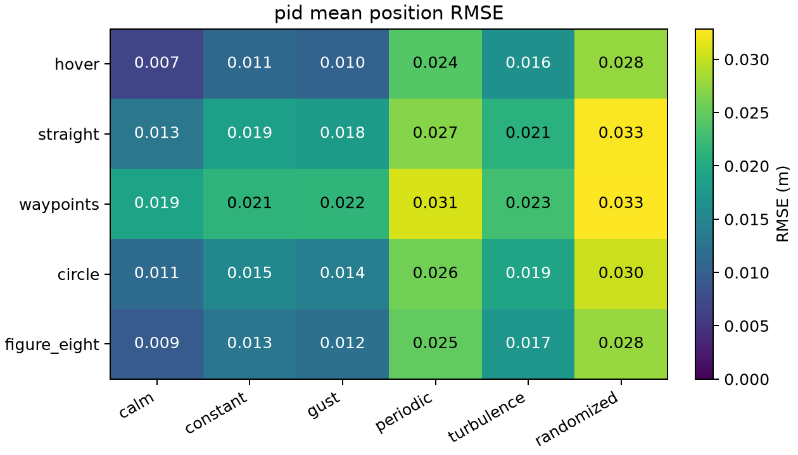
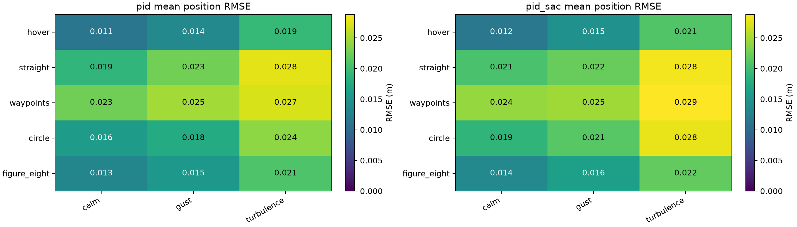
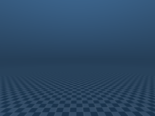
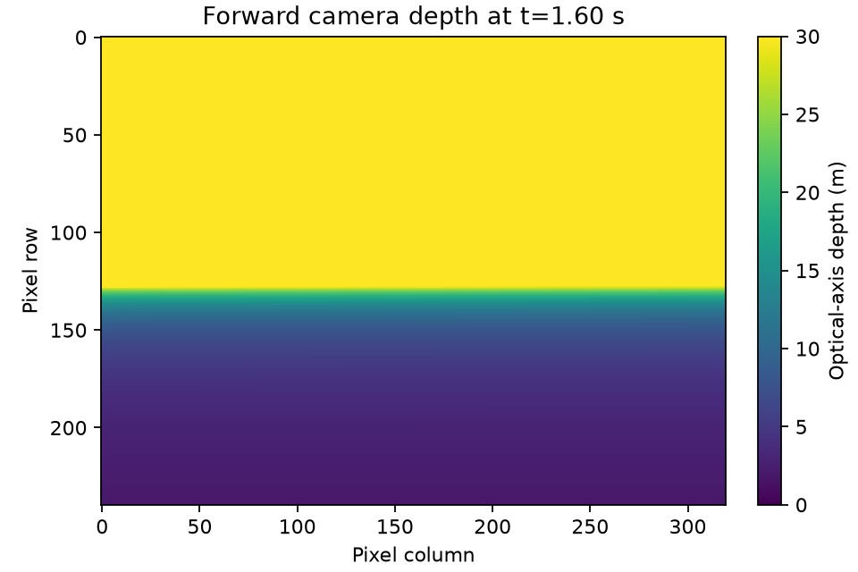

# Measured MuJoCo validation — 2026-11-05

This is the historical open-scene report. The subsequent warehouse/Dijkstra and
original-protocol measurements are in [MUJOCO_NAVIGATION_RESULTS.md](MUJOCO_NAVIGATION_RESULTS.md).

The implemented framework supports repeatable environmental experiments on the
Skydio X2, using an adaptation of the original `main.py` PID. The measured runs
below establish a stable simulated baseline over the tested tasks and wind
realizations. They do not establish real-aircraft accuracy, rare-event safety,
SAC convergence, or agreement with Isaac Sim.

Small review artifacts are in [results/2026-11-05](../results/2026-11-05/).
Complete CSVs, metadata, references, checkpoints and camera arrays remain in the
ignored local `mujoco_output/` directory. Nothing was pushed or committed.
All original MuJoCo input hashes in `ORIGINAL_SOURCES.json` were rechecked and
matched. The active working branch is `alan/mujoco`.

## Test environment and verification

Apple Silicon arm64, macOS 15.2, Python 3.11.17, MuJoCo 3.15.0, NumPy 2.4.6,
simple-pid 2.0.1, Gymnasium 1.4.0, SB3 2.9.2 and CPU PyTorch 2.15.0. The exact
direct dependency versions are recorded in `requirements-macos-tested.txt`.

* New suite: **28 passed**, one rendering test intentionally skipped by default.
* Explicit graphics test: **1 passed**, including RGB shape/type and depth
  against a known 1.4 m floor distance.
* Physics checks: weight balance, compiled inertia, three torque signs and
  magnitudes, freejoint/world/COM transforms, wind torque about COM, and clipping.
* Weather checks: zero drag at zero relative velocity, quadratic speed scaling,
  dissipative drag, exact seeded replay, reset and gust timing.
* Flight/interface checks: 120 s perturbed hover without secular drift; analytic
  trajectory derivatives; finite 128-value observations; Gymnasium/SB3 checker;
  all curriculum-stage resets/stepping; early failure and partial final decisions.
* Learning checks: actual gradients, prediction, saved-policy compatibility,
  replay-buffer resume, and rejection of incompatible/unknown checkpoints.
* Packaging: a wheel was built, checked for MJCF/mesh/texture/license/shared
  modules, and installed into a separate temporary environment. Model inspection
  succeeded with the working directory outside the repository.

The existing Isaac tests produced three failures: the sloped-route clearance
test, the IMU-bias drift magnitude test, and a wind test expecting a stale 10 m/s
default when the current configuration is 1.5 m/s. The same three failures were
reproduced from untouched `HEAD` extracted into an isolated temporary directory.
They were not hidden or changed to make the suite green. Isaac/PhysX execution,
USD scene behavior, and the interactive macOS viewer were not tested.

## Original controller diagnostic

`configs/original_pid_replay.json` uses the literal original feedback/mixer,
deterministic 100 Hz inner / 5 Hz outer timing, seed 17, and a 120 s scheduled
calm hover. It reached the **6 rad/s angular-speed failure threshold at 15.17 s**.
This was a threshold failure, not a detected crash. Position RMSE before stopping
was 0.08739 m. The quaternion yaw-feedback and integer planner issues remain in
this diagnostic by design.

It uses the common model/drag/integrator and deterministic timing, so this is
not an exact replay of the original GUI's wall-clock execution. It demonstrates
why the old controller cannot simply be assumed stable before evaluating wind.
The adapted baseline's fixes and changed behavior are documented in
[MUJOCO_DIFFERENCES.md](MUJOCO_DIFFERENCES.md).

Raw diagnostic: `mujoco_output/original_review_20261105/`.

## PID environmental matrix

Five tasks × six weather profiles × three seeds (300000–300002): **90 flights**,
all completed, with zero threshold failures, collisions or motor clipping.
The matrix contains 3,687.6 simulated flight seconds. Each hover lasts 60 s;
moving tasks include initial and final holds. Initial position, attitude and
velocity perturbations are sampled consistently from the saved configuration.

| Metric over all 90 flights | Measured value |
| --- | ---: |
| Mean per-flight position RMSE | 0.019863 m |
| Sample standard deviation of per-flight position RMSE | 0.008718 m |
| Mean cross-track RMSE | 0.014503 m |
| Mean altitude RMSE | 0.002133 m |
| Largest time-indexed position deviation in any flight | 0.123349 m |
| Completion / failure / crash rate | 100% / 0% / 0% |
| Motor clipping rate | 0% |

Profiles use still air; constant (0,3,0) m/s; a (0,4,0) m/s pulse from 5–7 s;
a 4 m/s amplitude, 0.25 Hz sinusoid; a (0,3,0) m/s mean plus OU turbulence; or
a seeded horizontal mean sampled between 0–6 m/s plus OU turbulence. The random
profile's 0–6 m/s bound applies to its mean, not to every instantaneous gust.
All profiles use the assumed Cd=1, total area=.03 m² and rho=1.225 kg/m³.

The mild gust cases remained inside the recovery bands at gust end, so the
reported sustained-recovery delay is zero. This does not imply that their
tracking error was zero. Stronger gusts below give a more informative recovery
measurement. These are deliberately modest flight speeds and disturbances,
not an exhaustive stability envelope.

Raw matrix: `mujoco_output/pid_review_20261105/`.

## SAC training and independent paired evaluation

Fresh seed-0 training ran **20,000 SAC decisions with 15,000 gradient updates**.
The final model, replay buffer, settings and contract are saved under
`mujoco_output/sac_review_20261105/`. The measured checkpoint is
`final_model.zip`. The run remains entirely in the first `short_slow` stage;
later curriculum stages have not been trained.

Evaluation used new seeds 400000–400002, all five tasks, and calm, gust and
turbulent weather: **45 paired cases, 90 flights**. A pair has the same reference,
initial state and wind realization; PID+SAC may experience different drag forces
because it flies a different state. All flights completed without failures or
motor clipping.

| Mean metric | PID | PID+SAC | SAC minus PID |
| --- | ---: | ---: | ---: |
| Position RMSE (m) | 0.019672 | 0.021049 | +0.001377 |
| Cross-track RMSE (m) | 0.015771 | 0.016653 | +0.000882 |

The short-trained residual **did not improve average tracking RMSE** on this
matrix. Its average maximum-deviation change was -0.001207 m, while altitude
RMSE increased by 0.000208 m. These small mixed changes do not establish an
overall controller improvement.

Raw paired evaluation: `mujoco_output/paired_review_20261105/`.

## Stronger gust recovery

`configs/gust_stress.json` applies an 8 m/s lateral pulse from 5–7 s. Hover and
straight tasks, seeds 500000–500002, produce **6 further pairs, 12 flights**.
Both modes completed every flight without failures or clipping.

| Task / metric, mean of three seeds | PID | PID+SAC |
| --- | ---: | ---: |
| Hover position RMSE (m) | 0.033348 | 0.034691 |
| Straight position RMSE (m) | 0.053767 | 0.052032 |
| Hover recovery delay after gust end (s) | 0.7167 | 0.7500 |
| Straight recovery delay after gust end (s) | 0.7167 | 0.7333 |

Recovery requires one full second inside both bands: position error <=.15 m and
velocity error <=.2 m/s. Across all six pairs the RMSE difference was -0.000196 m,
with sample standard deviation 0.001739 m. This small three-seed result is not
evidence of general superiority. The largest observed deviation across these
PID flights was .206798 m; across PID+SAC flights it was .193243 m.

Raw stronger-gust evaluation: `mujoco_output/stress_review_20261105/`.

## Sensor capture

A separate 3 s flight saved 360 synchronized flight/IMU rows and 16 RGB/depth
frames at 320×240, including the initial frame. The model's original onboard
camera and IMU site are used. Raw files are under
`mujoco_output/camera_capture_20261105/`. Sample images and a flight plot are
included in the review artifacts.

The renderer emitted the macOS `ARB_clip_control` precision warning. The near
plane-distance test passed with 2 mm tolerance; arbitrary far-range accuracy
remains unverified. Sandboxed plotting also emitted font-cache warnings, but
the exported figures were generated and visually inspected. None of these
sensors include calibrated real-world noise, exposure, rolling shutter or depth
dropout. The controller does not use camera or IMU estimation for navigation.

## Reproduction and evidence limits

Run `bash scripts/reproduce_mujoco_validation.sh mujoco_output/reproduction`
after installation. Optional camera tests require `DRONE_RENDER_TEST=1` and
macOS graphics access. The checked-in CSVs are measured outputs, not synthetic
fixtures. `ARTIFACTS.json` records their original raw paths and hashes.
Intermediate development runs are separate from the `*_review_20261105` runs
used in this report. One intermediate evaluation correctly stopped after source
changes made its checkpoint contract incompatible; it is excluded here.

Across the three final matrices, 192 adapted-controller flights completed.
Only the original diagnostic failed. Three seeds per condition and short
durations cannot establish a rare-failure probability or an unlimited-duration
stability guarantee. The short policy's training/checkpoint/evaluation plumbing
is validated; its robustness and later curriculum competence are unverified.

No matched Isaac evaluation table was available and Isaac cannot be run in this
local backend. Consequently there is **no measured claim of Isaac–MuJoCo
agreement**. Different drone models, PID adaptations, actuator units, inertia,
wind point geometry, trajectory schedules and numerical methods would confound
such a claim. Real aerodynamic parameters, motor dynamics, obstacle navigation,
sensor-based autonomy and real-flight transfer remain outside this validation.
